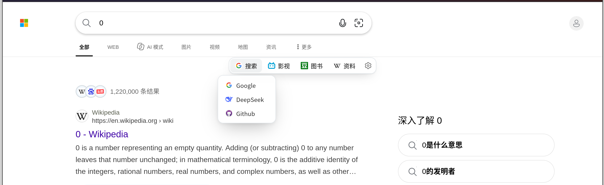
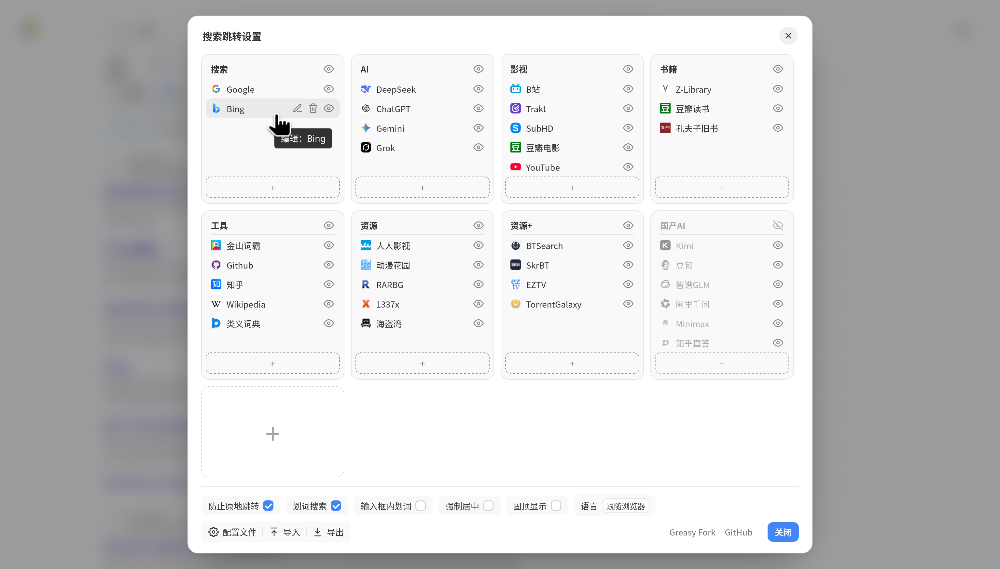

# SearchEngineJumpPlusPlus 搜索引擎快捷跳转++

多搜索引擎快捷跳转的最佳脚本, 现在焕然一新。

本项目 Fork 自 MUTED64 的 [SearchEngineJumpPlus](https://github.com/MUTED64/SearchEngineJumpPlus)。

用 Vue3 重构, 修复诸多问题, 并进行了大幅简化,美化和优化。

支持中英文界面, 默认跟随浏览器语言, 也可在设置面板中手动切换。

安装地址:

- https://github.com/sherlocknieh/SearchEngineJumpPlusPlus/raw/main/dist/SearchEngineJump++.user.js

## 新版效果

### 主界面

### 设置界面

## 新版特性

- 触屏操作优化:
  - 现在点击跳转条上的条目不再直接跳转, 而是显示悬浮面板;
  - 点击后跳转条上的图标会变成"一键搜索"图标, 点击图标即可打开多个搜索引擎快速搜索;
  - 窄屏下界面不会被遮挡, 可以正常显示;
- 设置界面优化:
  - 支持更直观的拖动移动操作逻辑;
  - 支持复制搜索引擎: 拖动搜索引擎到加号上放开时, 会在该分类下复制一个相同的搜索引擎;
  - 每次发生修改后, 能自动保存配置;
  - 支持一键导入/导出配置文件;
  - 支持合并导入: 使用合并导入时不会清空现有引擎数据, 而是追加到现有的引擎列表中。
- 引擎设置操作优化:
  - 输入搜索引擎链接, 自动填写搜索引擎名称和图标链接;
  - 多渠道图标获取: 支持从多方服务获取图标, 提高图标质量;
  - 支持快捷动作引擎: 在编辑弹窗中把引擎设为"复制当前内容"或"打开当前链接", 无需填写链接;
- 增加英文支持;

## 开发指南

[开发指南](/README-dev.md)
