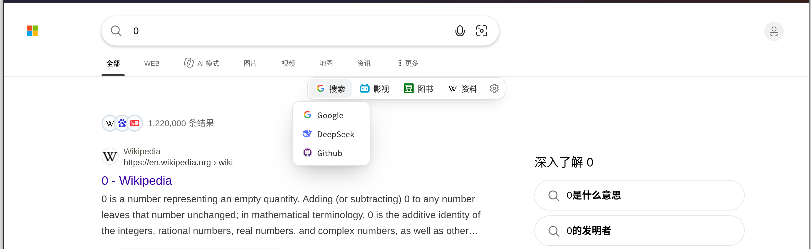
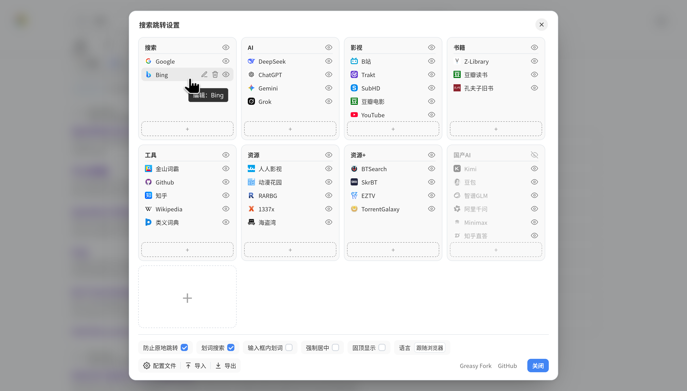

# 🔎 SearchEngineJump++ 搜索引擎快捷跳转++

> 🚀 Multi-engine quick jump, plus selection search, long-press / right-click actions and image search.
> 多引擎快捷跳转，外加划词即搜、长按 / 右键操作与以图搜图。

**Install / 安装**

- https://github.com/sherlocknieh/SearchEngineJumpPlusPlus/raw/main/dist/SearchEngineJump++.user.js
- https://greasyfork.org/zh-CN/scripts/602191-searchenginejump

## 📷 Screenshots / 新版效果

### Jump bar / 主界面

### Settings / 设置界面

## 🧭 Core / 核心

**🧩 Jump bar / 跳转条** — Your engines in one categorized bar; one click switches engine and reruns the query.
常用引擎按分类排成一条，点一下换引擎重搜当前关键词。

- ⚡ Open several engines at once / 一键打开
- 🪟 New tab · background tab · same tab / 新标签页 · 后台标签页 · 当前页

**✂️ Selection search / 划词搜索** — Select text and the bar pops up.
选中文字即弹出划词条。

- 🎯 Follows the selection while scrolling / 跟随选区，滚动时持续贴近
- 🏷 Compact mode: icons only / 紧凑模式：只留图标
- 🗂 Collapsed mode: one icon, expands on hover or click / 折叠模式：收成一个图标，悬停 / 点击展开

**🖼 Image search / 图片搜图** — Long-press or right-click an image to search it.
长按或右键图片即可搜图。

- 🧷 `` · lazy-loaded `data-*` · CSS backgrounds / ``、懒加载 `data-*`、CSS 背景图
- 🖱 Native menu stays / 不拦截原生菜单

**🔗 Link actions / 链接操作** — Long-press or right-click a link.
长按或右键链接即可操作。

- 📋 Copy title or URL / 复制标题、地址
- 🖱 Select the title / 选中标题
- ↗️ Open the link / 打开链接

**🧱 Actions category / 操作分类** — Built-in copy text/image, copy link, open link/image.
内置复制文字 / 图片、复制链接、打开链接 / 图片。

- ✏️ Rename and reorder / 可改名、排序
- 🎚 Toggle per trigger: selection, keyword, long-press / right-click / 按场景开关：划词、关键词、长按 / 右键

## ⚙️ Setup / 配置

- 📝 **Adding engines / 引擎录入** — Paste a URL to fill in name and icon, query becomes `%s` / 粘贴链接自动补全名称与图标，关键词转 `%s`
- 🔀 **Order & duplicate / 排序与复制** — Drag to reorder, drop on ➕ to duplicate / 拖动排序，拖到 ➕ 复制一份
- 💾 **Save & backup / 保存与备份** — Auto-save, import / export / merge, undoable deletes / 改动自动保存，导入 / 导出 / 合并，删除可撤销
- 🌐 **UI / 界面** — Bilingual, adaptive dark theme, cross-tab sync / 中英双语，深色自适应，跨标签页同步
- 📱 **Touch & narrow screens / 触屏与窄屏** — Drag the bar sideways when it overflows / 条过宽可横向拖动

## 🛠 Development / 开发指南

See [README-dev.md](./README-dev.md) for the dev server, CSP debugging, build and release flow.
开发环境、CSP 调试、构建与发布流程见 [README-dev.md](./README-dev.md)。

## 🧬 Origin / 来源

> Rebuilt with Vue 3 from MUTED64's SearchEngineJumpPlus, with numerous fixes and a much simpler, cleaner, faster UI. MIT licensed.
> Vue 3 重构自 MUTED64 的 [SearchEngineJumpPlus](https://github.com/MUTED64/SearchEngineJumpPlus)，修复诸多问题并大幅简化、美化与优化。MIT 许可。

Repo / 仓库: https://github.com/sherlocknieh/SearchEngineJumpPlusPlus

---

**🏷 Listing summary / 脚本摘要**

🔎 Multi-engine jump bar with selection search, long-press and right-click actions, and image search. Vue 3 rebuild, bilingual UI.
🔎 多引擎快捷跳转：划词即搜、长按 / 右键图片与链接、以图搜图。Vue3 重构，中英界面。
