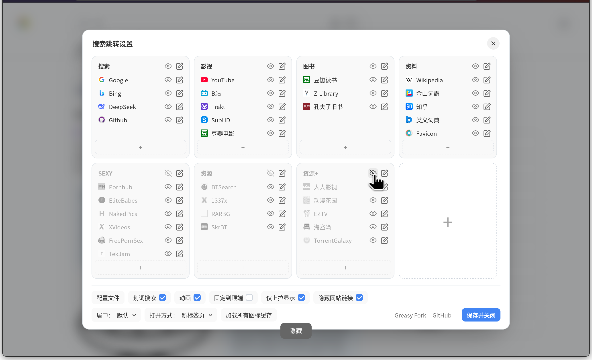
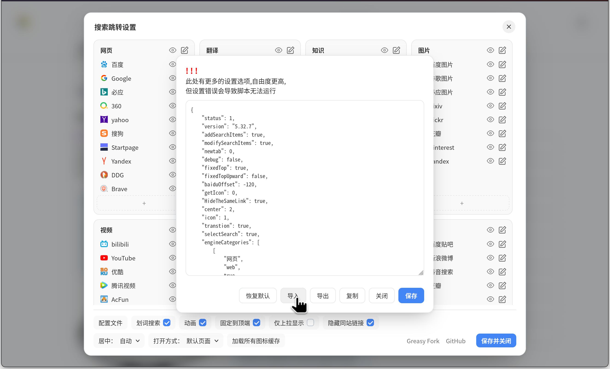

# SearchEngineJumpPlusPlus 搜索引擎快捷跳转++

多搜索引擎快捷跳转的最佳脚本, 现在焕然一新。

本项目 Fork 自 MUTED64 的 [SearchEngineJumpPlus](https://github.com/MUTED64/SearchEngineJumpPlus)。

用 Vue3 重构, 修复诸多问题, 并进行了大幅简化,美化和优化。

安装地址: 

- https://github.com/sherlocknieh/SearchEngineJumpPlusPlus/raw/main/dist/SearchEngineJump++.user.js

## 新版效果

### 主界面


### 设置界面



### 导出设置




## 开发环境

- 基本环境:
    - [Node.js](https://nodejs.org/)
    - [pnpm](https://pnpm.io/installation)

- 用到的库 (无需手动安装, `pnpm dev` 会自动安装):
    - Vue3
    - [vite-plugin-monkey](https://github.com/lisonge/vite-plugin-monkey)

- 开始调试
    ```bash
    pnpm dev
    ``` 
    浏览器打开 `http://localhost:5173` 可实时查看效果。
    开发脚本 (`server:SearchEngineJump++`) 可以和已安装的正式版同时运行，开发版会排在正式版下方，互不遮挡；菜单里开发版显示为「设置菜单（开发版）」。

- 打包构建
    ```bash
    pnpm build
    ```
    构建完成后, 会在 `dist` 目录下找到生成的脚本文件。


## TODO

- [ ] 太早移动鼠标到搜索条上时, 悬浮面板有概率不显示
- [ ] 问题: 划词搜索时, 设置为"在当前页打开"的引擎也只会新标签打开
- [x] 整理出一版更现代的默认引擎列表
- [x] 适配移动端网页和手机触屏操作
- [x] 图标加载优化: 用户更改图标链接时不要清空之前的图标缓存, 用户点击确认按钮时自动在后台加载图标;
- [x] 优化图标获取逻辑: 尝试从多方服务获取图标, 支持本地上传图标
- [x] 设置界面优化: 优化各设置按钮的相对位置, 优化悬浮提示
- [x] 配置文件优化: 精简不必要的字段, 导出文件名固定为 `SearchEngineJump.json`
- [x] 设置保存优化: 发生重要编辑时自动保存并同步
- [x] 支持复制搜索引擎: 把已存在的搜索引擎拖动到加号上放开时, 在该分类下复制一个相同的搜索引擎; 
- [x] 去掉条目编辑按钮: 点击项目不再是显示/隐藏, 而是进入编辑
- [x] 设置界面拖动优化: 实现最直观的拖动调整位置效果, 展示其他元素被挤到新位置的过程
