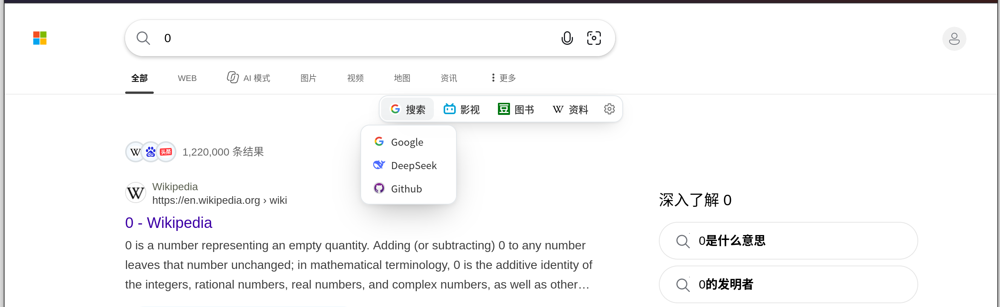
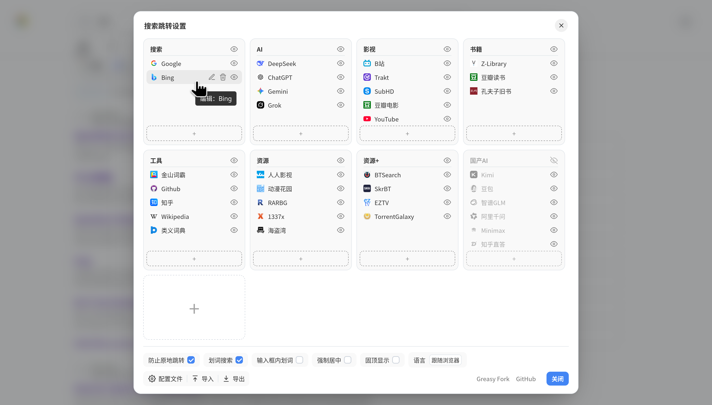

# SearchEngineJumpPlusPlus 搜索引擎快捷跳转++

多搜索引擎快捷跳转的最佳脚本, 现在焕然一新。

本项目 Fork 自 MUTED64 的 [SearchEngineJumpPlus](https://github.com/MUTED64/SearchEngineJumpPlus)。

用 Vue3 重构, 修复诸多问题, 并进行了大幅简化,美化和优化。

支持中英文界面, 默认跟随浏览器语言, 也可在设置面板中手动切换。

安装地址:

- https://github.com/sherlocknieh/SearchEngineJumpPlusPlus/raw/main/dist/SearchEngineJump++.user.js
- https://greasyfork.org/zh-CN/scripts/602191-searchenginejump

## 新版效果

### 主界面

### 设置界面

## 新版特性

- 触屏操作优化:

  - 现在点击跳转条上的条目不再直接跳转, 而是显示悬浮面板;
  - 面板末尾提供"一键搜索", 点击即可打开该分类下的多个搜索引擎快速搜索;
  - 再次点击条目则收起面板;
  - 窄屏下界面不会被遮挡, 可以正常显示;

- 设置界面优化:

  - 支持更直观的拖动移动操作逻辑;
  - 支持复制搜索引擎: 拖动搜索引擎到加号上放开时, 会在该分类下复制一个相同的搜索引擎;
  - 每次发生修改后, 能自动保存配置;
  - 支持一键导入/导出配置文件;
  - 支持合并导入: 使用合并导入时不会清空现有引擎数据, 而是追加到现有的引擎列表中。

- 引擎设置操作优化:

  - 输入搜索引擎链接, 自动填写搜索引擎名称和图标链接;
  - 自动解析搜索引擎链接, 把关键词替换为占位符, 例如 `https://www.google.com/search?q=关键词` -> `https://www.google.com/search?q=%s`;
  - 多渠道图标获取: 支持从多方服务获取图标, 提高图标质量;
  - 支持快捷动作: 内置「快捷」分类提供"复制当前内容"与"打开当前链接", 默认排在列表首位;
  - 内置「快捷」分类默认存在且不可删除, 其余编辑、排序与隐藏操作与其他分类一致;

- 图片搜图:

  - 在图片上长按（桌面按住鼠标、手机长按）或右键即可用「搜图」分类的引擎搜索图片链接;
  - 右键不拦截浏览器原生菜单, 跳转条与系统菜单同时出现;
  - 复用独立的划词条：只显示「搜图」分类，以图标收起、悬停或点击图标展开，点外部 / Escape / 滚动收起;
  - 支持 `` 与背景图，懒加载图片会读取 `data-*` 上的真实地址;
  - 「搜图」分类内置 Google Lens 与 Yandex Image, 可自行增删改; 该分类默认不隐藏, 但只出现在图片搜图条上, 不会占用普通跳转条;

- 划词搜索:

  - 划词条独立出现, 不影响页面里原本的跳转条;
  - 默认从页面顶部滑出; 开启「跟随选区」后出现在选中文字的右上角, 长按搜图时出现在图片右上角, 滚动页面时继续贴着选区;
  - 开启「图标模式」后划词只出现一个图标, 鼠标悬浮或点击图标才展开搜索条, 指针移开自动收回;
  - 点划词条上的引擎即可用选中文字搜索, 选择新文字会直接更新;
  - 点页面其它位置或按 Escape 收起;

- 增加英文支持;

## 开发指南

[开发指南](/README-dev.md)
